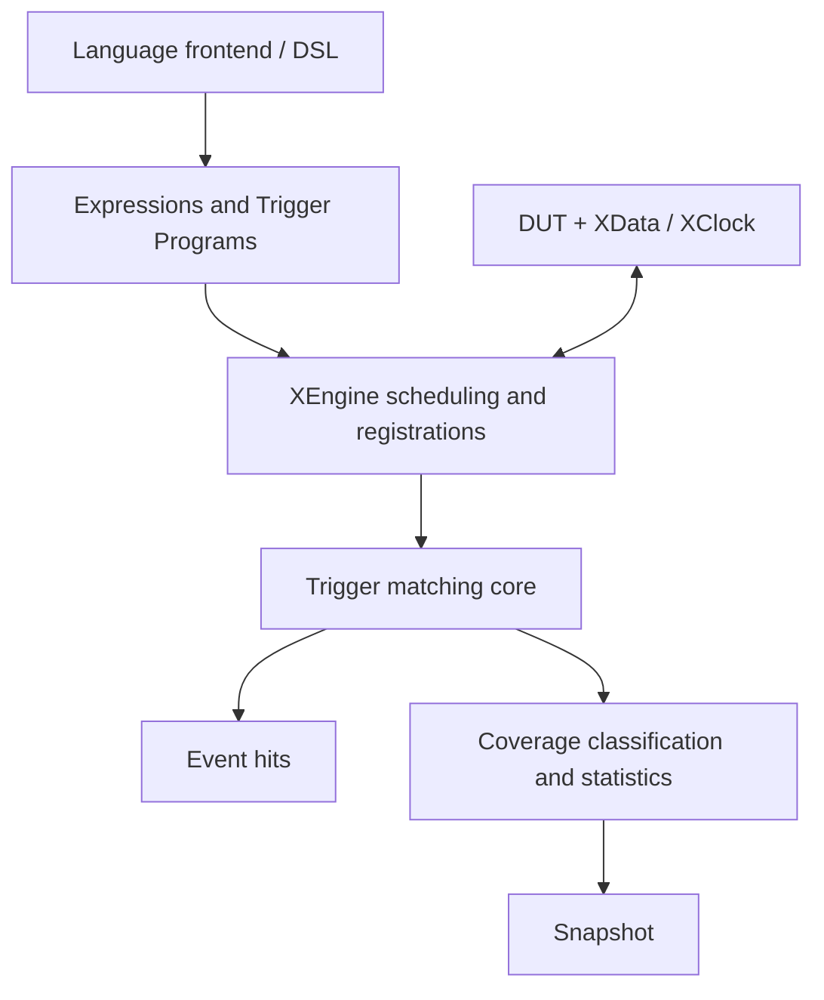

# Architecture: language definitions to native execution

xcomm provides simulation components for verification frameworks. A language frontend defines waits and CoverPoints/CoverBins, compiling them into expressions, temporal programs, and coverage descriptors. xcomm executes matching and statistics in C++. The DUT connects to the simulator through signal access and clock interfaces.

## Why Trigger and Coverage share a core

XTriggerProgram describes an Expression, Sequence or FSM, including event mode and overlap capacity. Separate executions own temporal history. Ordinary triggers turn matches into waiting events; Coverage turns the same matching results into bin counts, Illegal/Ignore classification and Cross statistics.

Coverage reuses Trigger program descriptions, validation, and matching. An ordinary Trigger returns an event on a hit; Coverage updates statistics. A CoverPoint defines the observed object, sampling gates, and statistical context. A CoverBin belongs to a point and supplies a program, selected terminals and classification policy. Separating matching from statistics gives frontends a consistent IR target.

Equivalent programs within one point can share execution while bins retain separate counts. Different points and registrations keep independent history. Cross correlates Normal hits of preceding Value points in the same sample; correlation of Pattern completions across points is not part of the current protocol. See [Coverage](../reference/coverage.md).

## Who drives the clock

XClock handles DUT writes, edge updates, reads and callbacks. After acquiring the clock, XEngine calls its native half-cycle entry, evaluates expressions and matchers at stable phases, then returns hits. The frontend calls RunUntil, the engine drives the clock, and execution returns to the frontend when it needs to handle an event.

Construction does not acquire the clock, allowing manual initialization. From AcquireClock until cleanup and ReleaseClock, manual driving is rejected even between RunUntil calls. This prevents an execution context from missing events caused by another driving path. This ownership coordinates single-threaded scheduling.

Monitors provide a separate edge callback API. Attach schedules checks; BindXClock selects clocks to stop on a hit. Attach/Detach manage callback lifetimes without converting a monitor into an engine registration handle.

## Expressions and lifetime

ExprEngine provides legacy uint64 nodes, full-width comparisons and typed Bits/Bool nodes. Typed arithmetic and Coverage reuse the expression graph, XData bytes, and common comparison algorithms. NewBits expresses width/sign/cast explicitly; text CompileExpr preserves legacy numeric semantics.

A root is an index within one graph. Collect/CollectExpressions removes unreachable nodes at an idle safe point and returns a mapping. The engine retains occupied registrations and Coverage references automatically; frontends supply and remap additional roots. Collection preserves matcher history and counters and does not own or release borrowed DUT signals.

## Source responsibilities

| Directory/entry | Responsibility and boundary |
| --- | --- |
| include/xspcomm/xdata.h, xport.h, xclock.h | Signals, ports and clocks |
| xexpr.h, xpattern.h, xcoverage.h, xengine.h | Expressions, matching descriptors, coverage descriptors and execution |
| runtime/types.h | Phase/handle/hit/result protocol, independent of clock implementation |
| common/ | Comparisons, exact-width memory access, strings/memory and public-template helpers |
| monitor/, xmonitor.h | Condition, range, expression, text-FSM and output callbacks |
| src/data/ | Storage, values/comparison, native/DPI/VPI backends and PinBind; native_memory.h is private |
| src/core/ | Clock, port, coroutines and YAML configuration; YAML dependencies stay out of public headers |
| src/expr/ | Graph construction, scalar/typed evaluation, compilation and collection |
| src/trigger/ | Program validation, single-execution advancement, overlapping matchers and ordinary registrations; no Coverage dependency |
| src/coverage/ | Coverage execution state, registration, classification and counters |
| src/runtime/ | Phase loop and shared registration lifetime; private Watcher combines trigger and optional coverage state |
| swig/ | Shared and language-specific wrappers; native and JS builds share cmake/Sources.cmake |
| integrations/tlm/ | SystemC/UVM bridge source SDK |
| tests/{unit,bindings,integration,fixtures} | Native, language, simulator tests and fixtures |
| third_party/ | fkYAML/Catch2 with their licenses |

The installed SDK contains include/xspcomm and generated xconfig.h. Pure implementation headers stay under src and are not installed. Helpers needed by public templates belong in common; their internal namespace may still be detail. See [performance](performance.md) and [contributing](../development/contributing.md).
