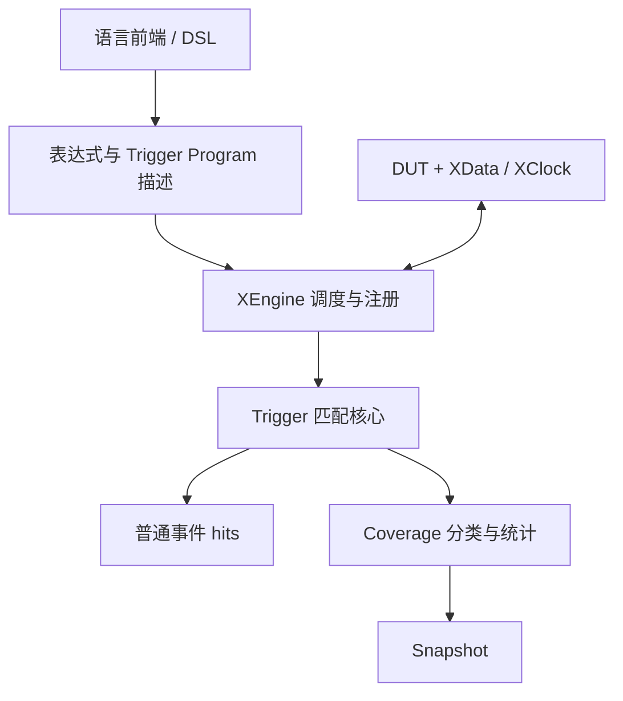

# 架构：从语言定义到原生执行

xcomm 为验证框架提供仿真运行组件。语言前端定义等待条件与 CoverPoint/CoverBin，将它们编译为表达式、时序程序和覆盖率描述；xcomm 在 C++ 中执行匹配和统计。DUT 通过信号读写与时钟接口连接到模拟器。

## Trigger 与 Coverage 为什么共享核心

XTriggerProgram 描述 Expression、Sequence 或 FSM，包括事件模式和重叠容量；运行中的历史由独立 execution 持有。普通 Trigger 将匹配结果转换为等待事件，Coverage 将相同匹配结果转换为 bin 计数、Illegal/Ignore 分类和 Cross 统计。

Coverage 复用 Trigger 的程序描述、验证和匹配过程。普通 Trigger 命中后返回事件，Coverage 命中后更新统计。CoverPoint 定义观察对象、采样门控和统计上下文；CoverBin 归属于一个 point，并携带 program、终态选择和分类策略。运行时将匹配机制和统计策略分开，方便前端生成 IR。

同一点中 program 完全等价的 bins 可共享执行，仍各自计数。不同点或注册保留独立历史。Cross 只关联同次采样中先前 Value 点的 Normal 命中；Pattern 的跨点完成关联目前不在协议中。详见 [Coverage](../reference/coverage.md)。

## 谁推进 clock

XClock 负责 DUT 的写入、边沿更新、读取和回调。XEngine 取得时钟控制权后调用它的原生半周期入口，在稳定相位运行表达式和 matcher，再返回 hits。前端调用 RunUntil，engine 推进 clock，并在需要处理事件时返回给前端。

构造 engine 不接管时钟，便于手动初始化。AcquireClock 后直到清理并 ReleaseClock，所有手动驱动都被拒绝，包括两次 RunUntil 之间的暂停。这个限制避免一个执行上下文漏掉另一路推进造成的事件；这套所有权用于协调单线程调度。

Monitor 则是独立的边沿回调接口：Attach 安排检查，BindXClock 指定命中后停止哪些时钟。Attach/Detach 管理回调注册寿命；不会把 Monitor 转换成 engine 的注册 handle。

## 表达式和生命周期

ExprEngine 同时提供旧 uint64 节点、完整宽度比较和 typed Bits/Bool 节点。typed 算术和 Coverage 复用同一表达式图、XData 字节及公共比较算法。NewBits 显式表达 width/sign/cast；文本 CompileExpr 保持旧数值语义。

表达式 root 是图内索引。Collect/CollectExpressions 在停止运行的安全点删除不可达节点并返回映射；engine 自动保留占槽注册和 Coverage 引用，前端负责额外 roots 及其映射。回收保留 matcher 历史和计数，不拥有或释放借用的 DUT 信号。

## 源码职责

| 目录/入口 | 职责与边界 |
| --- | --- |
| include/xspcomm/xdata.h、xport.h、xclock.h | 信号、端口和时钟接口 |
| xexpr.h、xpattern.h、xcoverage.h、xengine.h | 表达式、匹配描述、覆盖率描述、运行入口 |
| runtime/types.h | phase/handle/hit/result 协议；不依赖时钟实现 |
| common/ | 比较、精确宽度内存访问、字符串/内存及公共模板需要的辅助类型 |
| monitor/、xmonitor.h | 条件、范围、表达式、文本 FSM 与打印回调 |
| src/data/ | 存储、值/比较、native/DPI/VPI backend、PinBind；native_memory.h 为私有适配器 |
| src/core/ | clock、port、协程、YAML 配置；YAML 库不进入公共头依赖 |
| src/expr/ | 图构造、标量/typed 求值、编译与回收 |
| src/trigger/ | 程序验证、单 execution 推进、重叠 matcher、普通注册；不依赖 Coverage |
| src/coverage/ | Coverage 执行状态、注册、分类和计数 |
| src/runtime/ | 相位循环和共有注册寿命；私有 Watcher 组合 trigger 与可选 coverage 状态 |
| swig/ | 公共及语言特定包装；原生与 JS 源文件清单共用 cmake/Sources.cmake |
| integrations/tlm/ | SystemC/UVM 桥源码 SDK |
| tests/{unit,bindings,integration,fixtures} | 原生、语言、模拟器测试和配置数据 |
| third_party/ | 带原许可证的 fkYAML/Catch2 |

安装 SDK 包含 include/xspcomm 和生成的 xconfig.h。纯实现头留在 src，不安装；公共模板需要的辅助头放在 common，内部命名空间仍可使用 detail。详见[性能说明](performance.md)和[贡献指南](../development/contributing.md)。
